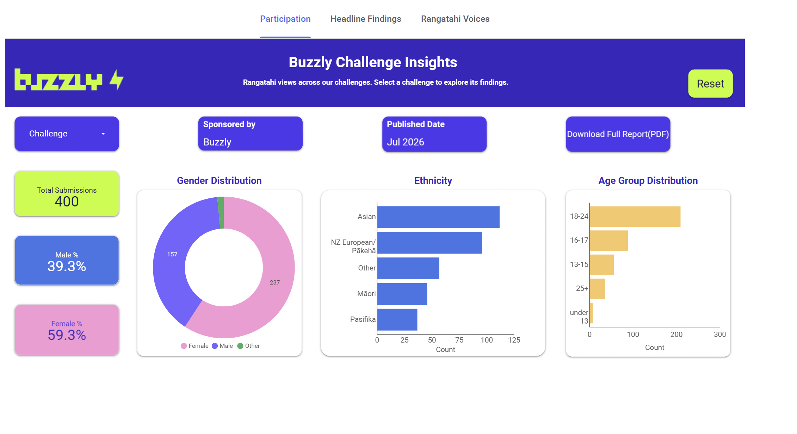

# Interactive Insights Automation (Looker Studio + AI-assisted cleaning)

End-to-end automation that turns raw youth-survey exports and their insight reports into
interactive, web-embeddable **Google Looker Studio** dashboards. Data cleaning is
**AI-assisted** (Google Apps Script + Gemini) with human review, and every published figure is
cross-checked against the source report.

An industry project delivered as part of a data analyst internship: converting youth-survey data
and insight reports into interactive, reusable dashboards.

---

## Problem

The organisation published its research as long PDF reports that most website visitors never read.
They needed a faster, more visual way to explore findings on the website, and a **repeatable**
process that could be reused for every future survey without rebuilding the site each time.

## Objective

- Convert each report + survey dataset into a short, interactive dashboard.
- Make it reusable across many surveys (one build, driven by a challenge selector).
- Keep every number traceable to the approved data and matching the formal report.
- Protect participant privacy (young respondents).

---

## What I built

**1. AI-assisted data-cleaning automation (Google Apps Script + Gemini)**
- Reads a raw survey export and cleans it into two modelled tables: one row per person, and one
  row per selected answer (for multi-select questions).
- **Gemini AI proposes** how messy free-text gender and ethnicity values map to standard
  categories; a **human reviews and approves** the mappings before they are applied (AI speed +
  human accuracy).
- Drafts headline findings, sentiment and participant quotes, all reviewed before publishing.

**2. Data modelling**
- Gender normalised with whole-word matching (handles "woman", "she/her", "boy", typos, etc.).
- Ethnicity handled as **multi-select** to match how the reports count it (a person can appear in
  more than one group), with a per-report option for single-select where the report requires it.
- Age derived from date of birth and bucketed into consistent age bands.

**3. Interactive dashboard (Google Looker Studio)**
- Participation (totals, gender, age, ethnicity), headline findings, and voices pages.
- A **challenge/survey dropdown** so one dashboard serves every survey.
- Embedded on the website with a **responsive iframe** (works on desktop and mobile).

**4. Quality & privacy**
- Every displayed figure cross-checked against the official report.
- Quotes shown with **anonymous age-group + gender only** (no names, emails, or postcodes).
- Personal columns stripped from all raw data before use.

---

## Tech stack

| Area | Tools |
|---|---|
| Automation / scripting | Google Apps Script, Gemini API (AI-assisted cleaning) |
| Data cleaning & modelling | Excel **Power Query**, Google Sheets |
| Sentiment (fallback) | Python (**TextBlob**) |
| Visualisation | **Google Looker Studio** (interactive dashboards + embed) |
| Delivery | Responsive HTML iframe embed |

---

## Process (repeatable workflow)

1. **Clean** the raw export (approved records only; normalise gender/ethnicity; split multi-select answers).
2. **Suggest mappings (AI)** -> review and approve gender/ethnicity groupings.
3. **Process** -> write cleaned tables, draft findings, sentiment and quotes.
4. **Verify** every number against the report.
5. **Publish** and embed the dashboard on the website.

Because the dashboard is built once and reused via the dropdown, adding a new survey is a short,
repeatable task rather than a rebuild.

---

## Outcomes

- Multiple surveys converted into interactive dashboards using the same reusable pipeline.
- Participation, gender and ethnicity figures matched the source reports on cross-check. Age was standardised into consistent bands; where an individual report used different bands, this was documented as a known difference.
- Fully anonymised, privacy-safe presentation of youth voices.
- Adding a new survey became a short, repeatable task instead of a full rebuild.

---

## Code highlights

A **generic, sanitised sample** of the cleaning logic is included here:
[`sample_cleaning_automation.gs`](./sample_cleaning_automation.gs) .

It demonstrates:

- `cleanGender()` - normalises messy free-text gender into Female / Male / Other using
  whole-word matching (handles "she/her", "I'm a boy", typos), with Female checked before Male.
- `classifyEthnicity()` - maps a single ethnicity term to a standard category.
- `ethnicityGroups()` - treats ethnicity as **multi-select** (a person can appear in several
  groups), with a human-reviewed mapping overriding the rules.
- `suggestMappings()` - the **AI-proposes / human-reviews** pattern (AI drafts category
  mappings; a person approves them before they are applied).
- `ageGroup()` - derives consistent age bands from age.

---

## Skills demonstrated

- AI-assisted data cleaning with human-in-the-loop review
- Data cleaning, modelling and ETL (Power Query)
- Interactive BI dashboard design and embedding (Looker Studio)
- Data accuracy / validation against a source of truth
- Data ethics & privacy (anonymisation, minimum group sizes, no PII)
- Stakeholder communication and repeatable documentation

# Machine Learning Projects (Microsoft Fabric + Python)

Two end-to-end machine learning projects built in **Microsoft Fabric notebooks** using **Python, pandas, and scikit-learn**, with experiment tracking in **MLflow** and data loaded from **Azure Blob Storage / OneLake**. Both follow the full workflow: load data, clean it, explore it (EDA), build and compare models, and evaluate the results.

> These are case studies built on public training datasets. The focus is the analytics method and modelling workflow. Full notebooks are kept private; this page summarises the approach, decisions, and results.

---

## Project 1 — Bank Customer Churn Prediction (Classification)

**Goal:** Predict which bank customers are likely to leave (churn), so the business can act early to retain them.

### Problem
Customer churn directly affects revenue. The bank wanted a way to flag customers at risk of leaving, using the data it already holds (credit score, balance, tenure, products, activity, and more), so retention effort could be focused where it matters.

### What I did
1. **Loaded the data** from Azure Blob Storage into a pandas DataFrame inside a Microsoft Fabric notebook.
2. **Exploratory Data Analysis (EDA)** — checked data types, missing values, and the balance of churned vs retained customers; explored how features like age, balance, and activity related to churn.
3. **Prepared the data** — encoded categorical fields (country, gender), scaled numeric features, and split into training and test sets.
4. **Built and compared models:**
   - Logistic Regression (baseline)
   - Random Forest (100 estimators)
   - Tuned Random Forest (150 and 300 estimators)
5. **Evaluated** each model with accuracy and a comparison of predicted vs actual churn, and tracked every run in MLflow.

### Outcome
- Compared several models side by side and identified the Random Forest as the stronger performer over the logistic baseline.
- Produced a clear predicted-vs-actual churn comparison the business could act on.
- All experiments logged in MLflow for repeatability.

### Tools
Microsoft Fabric · Python · pandas · scikit-learn · MLflow · Azure Blob Storage

### Skills demonstrated
- Classification modelling and model comparison
- Feature encoding, scaling, and train/test splitting
- Model evaluation (accuracy, confusion of predicted vs actual)
- Experiment tracking with MLflow
- Working with cloud data in Microsoft Fabric

---

## Project 2 — Uber Trip Price Prediction (Regression)

**Goal:** Predict the price of an Uber trip from trip and condition features.

### Problem
Trip price depends on several factors — distance, duration, time of day, traffic, and weather. The task was to model those relationships and predict the total trip price as accurately as possible.

### What I did
1. **Loaded the dataset** (trip distance, time of day, day of week, passengers, traffic, weather, fares, duration, and price) from Azure Blob Storage into a Fabric notebook.
2. **EDA** — explored how each feature related to price and checked for outliers and data quality issues.
3. **Prepared the data** — handled categorical features (time of day, traffic, weather) and split into training and test sets.
4. **Built and compared models:**
   - Multiple Linear Regression (baseline)
   - Random Forest Regressor
5. **Evaluated** both models using RMSE (Root Mean Squared Error) to measure prediction accuracy, tracked in MLflow.

### Outcome
- Built two working price-prediction models and compared them with RMSE.
- Showed how a Random Forest can capture non-linear patterns that a linear model misses.
- Clear, repeatable workflow from raw data to evaluated model.

### Tools
Microsoft Fabric · Python · pandas · scikit-learn · Matplotlib / Seaborn · MLflow · Azure Blob Storage

### Skills demonstrated
- Regression modelling and model comparison
- Exploratory Data Analysis and feature preparation
- Model evaluation with RMSE
- Experiment tracking with MLflow
- End-to-end ML workflow in Microsoft Fabric

---

## Also covered in this work
- **Exploratory Data Analysis** with pandas, Matplotlib, and Seaborn (sales and coffee-store case studies)
- **Time Series Forecasting** and **K-Means Clustering** (predictive modelling)
- **PySpark** and **data engineering** basics in Microsoft Fabric
- Data loading from **Azure Blob Storage** and **OneLake**

---

### Skills summary (across all ML work)
Python · pandas · scikit-learn · Machine Learning (Regression, Classification, Clustering) · Time Series Forecasting · Exploratory Data Analysis (EDA) · MLflow · PySpark · Microsoft Fabric · Azure Blob Storage · Data cleaning & preparation

